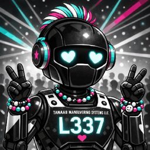
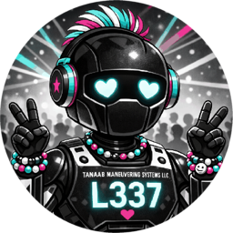

# tanaabot artwork

the **realistic set is primary**, preserving tanaabot's current GitHub robot. two
optional pixel treatments are available: L3-37 with the colorful rave background,
and L3-38 with the quieter spaceport background.

all six images are 256×256 PNGs. each circular image matches its square's framing
and has transparent corners. the previews below display them at 128 pixels.

| set                  | square                                                                              | circle                                                                                     |
| -------------------- | ----------------------------------------------------------------------------------- | ------------------------------------------------------------------------------------------ |
| primary realistic    |             |             |
| optional L3-37 pixel |     |     |
| optional L3-38 pixel |  |  |

only compact runtime images belong here; source artwork and working renders belong
in the separately managed asset archive. these files do not install a pet or select
a live profile. existing L3-37/L3-38 local pets, plugin branding, and the human
profile's artwork retain their existing homes.

choose the artwork before the separate
[cloud appearance setup pilot (#131)](https://github.com/pirog/me/issues/131).
